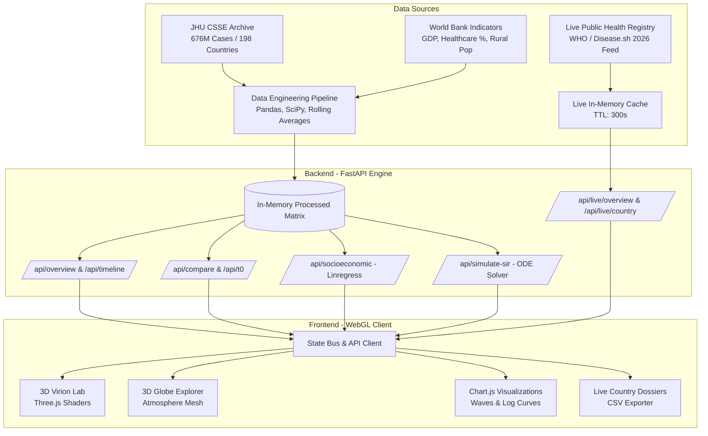

# 🌐 Pandemic Intelligence OS

<p align="center">
  
  
  
  
  
  
</p>

<p align="center">
  <strong>Next-Generation Global Epidemiological Surveillance, 3D WebGL Visualization & Outbreak Simulation Engine</strong><br>
  <em>Designed, Architected, and Engineered by <strong>Archit Srivastava</strong></em>
</p>

---

## 📑 Table of Contents

- [Overview](#-overview)
- [Key Highlights & Capabilities](#-key-highlights--capabilities)
- [System Architecture](#-system-architecture)
- [Technology Stack](#-technology-stack)
- [Modules & Core Features](#-modules--core-features)
- [Mathematical Modeling (SIR Engine)](#-mathematical-modeling-sir-engine)
- [Repository Structure](#-repository-structure)
- [Quick Start Guide](#-quick-start-guide)
- [API Reference](#-api-reference)
- [Author & Credits](#-author--credits)
- [License](#-license)

---

## 🔬 Overview

**Pandemic Intelligence OS** is a full-stack, enterprise-grade epidemiological intelligence and simulation platform. It bridges multi-million row public health records with dynamic mathematical modeling and GPU-accelerated 3D browser graphics.

The platform provides a **dual-engine data pipeline**:
1. **Historical Gold-Standard Archive (2020–2023):** Over **676 Million confirmed cases** across 198 countries from the Johns Hopkins CSSE repository, cross-correlated with World Bank macroeconomic, healthcare expenditure, and demographic indices.
2. **Live Real-Time Stream (2026 Current Feed):** Live automated pipeline synchronizing with WHO and Disease.sh global health registries, tracking over **704 Million cumulative cases, 22M+ active cases, and 7 Billion global tests** across 231 territories.

---

## ⚡ Key Highlights & Capabilities

* **Zero-Build Native Architecture:** High-performance Vanilla ES6+ modules and WebGL with zero npm build step, webpack, or bloated node dependencies.
* **Sub-Millisecond In-Memory Caching:** FastAPI backend caches vector datasets directly in RAM with GZip compression, returning API responses in `< 5ms`.
* **Procedural 3D Virion Anatomy Lab:** Real-time Three.js rendering of lipid membranes, RNA coils, and 68 glycoprotein spikes with live mutation coloring, breathing pulsations, and aerosol filtration simulation.
* **Interactive 3D Geospatial Globe:** Point-cloud landmass mesh with dynamic volumetric incident bubbles scaled to outbreak volume and colored by Case Fatality Rate (CFR).
* **Epidemic Policy Simulator:** Dynamic differential-equation SIR (Susceptible-Infected-Recovered) simulation engine with healthcare capacity thresholds and lockdown intervention scenarios.
* **$T_0$ Trajectory Normalization:** Time-series alignment normalizing countries from the day they reported their 100th confirmed case, revealing real curve-flattening efficacy.
* **Automated Data Export:** Client-side 1-click CSV generator for filtered country leaderboards and full historical date-by-date country dossiers.

---

## 🏗️ System Architecture



---

## 💻 Technology Stack

### Backend & Analytics
| Technology | Version | Purpose |
|---|---|---|
| **Python** | `3.9+` | Core backend programming language |
| **FastAPI** | `0.100+` | High-throughput asynchronous REST API framework |
| **Pandas & NumPy** | `Latest` | In-memory timeseries vector calculations & rollups |
| **SciPy** | `Latest` | Pearson correlation ($r$), $R^2$, and $p$-value statistical regressions |
| **Uvicorn** | `Latest` | Lightning-fast ASGI production web server |

### Frontend & Graphics
| Technology | Purpose |
|---|---|
| **Three.js** | GPU-accelerated WebGL 3D rendering (Globe & Virion particle) |
| **Chart.js** | Responsive, accessible timeseries and logarithmic trajectory plots |
| **Modern ES6+ JS** | Modular architecture with reactive event bus and zero build bloat |
| **Modern CSS Design System** | Custom tokens, dark/light responsive layout, reduced-motion accessibility |

---

## 🎯 Modules & Core Features

### 1. 📊 Executive Overview (`#overview`)
* Real-time headline ledger: Confirmed cases, Deaths, Mortality %, and Busiest single day.
* Dual-stream toggle: Switch between **2020–2023 Historical Archive** and **Live 2026 Real-Time Stream**.
* Interactive Global Wave Chart with 7-day smoothed average and logarithmic scaling.
* Continental distribution strips and hardest-hit country leaderboards.

### 2. 🌍 3D Geospatial Globe (`#map`)
* Interactive point-cloud 3D Earth rendered in WebGL with ambient atmospheric glow.
* Volumetric markers sized by outbreak size and colored by mortality risk.
* Smooth camera flight to coordinates upon country selection.

### 3. 📈 Multi-Country Comparative Analysis (`#compare`)
* Compare up to 8 countries simultaneously with dedicated color palettes.
* **$T_0$ Alignment:** Normalizes every outbreak to Day 0 (the day of the 100th case) to compare containment strategies objectively.
* Smart FIFO replacement queue, quick presets, and 1-click list clearing.

### 4. 🔬 Socioeconomic Correlation Engine (`#factors`)
* Evaluates ecological correlations between national indicators and pandemic outcomes:
  * **GDP per capita** vs. **Mortality %**
  * **Healthcare expenditure (% of GDP)** vs. **Cases per million**
  * **Life expectancy** vs. **Reported infections**
  * **Rural population %** vs. **Spread velocity**
* Outputs Pearson $r$, $R^2$, $p$-value, trend line, and automated natural language interpretation.

### 5. 🧮 Epidemiological SIR Simulator (`#simulator`)
* Interactive mathematical simulation engine based on the **Kermack-McKendrick SIR model**.
* Real-time adjustment of Reproduction Number ($R_0$), Infectious Period, Intervention Timing, and Transmission Cut %.
* **Healthcare Capacity Limit:** Visualizes hospital and ICU bed thresholds to analyze curve-flattening impact.

### 6. 📋 Countries Database & 1-Click CSV Export (`#countries`)
* Complete searchable database of 198+ nations and territories with continent filter pills.
* **Country Dossier Modal:** Deep-dive cards showing national statistics, historical curves, and live 2026 data (flags, active cases, total tests).
* **CSV Export:** Download filtered country tables or individual country timeseries history directly.

### 7. 🧪 3D Virion Anatomy Lab (`#lab`)
* High-detail 3D model of the SARS-CoV-2 virion:
  * S-glycoprotein spikes (host cell entry receptor)
  * Lipid membrane & viral envelope
  * Internal viral RNA core
* Interactive mask barrier simulation, pulse animation toggle, and mutation shader cycler.

---

## 📐 Mathematical Modeling (SIR Engine)

The simulation engine models infectious disease dynamics using the classical system of coupled non-linear differential equations:

$$\frac{dS}{dt} = -\frac{\beta S I}{N}$$

$$\frac{dI}{dt} = \frac{\beta S I}{N} - \gamma I$$

$$\frac{dR}{dt} = \gamma I$$

Where:
* $S$: Susceptible population
* $I$: Infectious individuals
* $R$: Recovered / Removed individuals
* $N$: Total population ($N = S + I + R$)
* $\gamma$: Recovery rate ($\gamma = \frac{1}{\text{infectious\_days}}$)
* $\beta$: Transmission rate ($\beta = R_0 \cdot \gamma$)

When a non-pharmaceutical intervention (lockdown) is introduced at day $t_{\text{lockdown}}$ with efficacy $\eta \in [0, 1]$:
$$\beta_{\text{effective}} = \beta \cdot (1 - \eta)$$
$$R_{\text{effective}} = R_0 \cdot (1 - \eta)$$

---

## 📁 Repository Structure

```text
Pandemic-Intelligence-OS/
├── data/
│   ├── processed/              # Cleaned analytical datasets
│   │   ├── confirmed_cases.csv
│   │   ├── dead_cases.csv
│   │   ├── confirmed_cases_daily_change.csv
│   │   ├── confirmed_cases_since_t0.csv
│   │   ├── country_stats.csv
│   │   ├── coordinates.csv
│   │   └── world_bank.csv
│   └── raw/                    # Raw source archives
├── web/
│   ├── server.py               # FastAPI backend & Live Data Pipeline
│   └── static/
│       ├── index.html          # SPA markup & SVG icon sprite
│       ├── styles.css          # Design system & tokens
│       ├── js/
│       │   ├── main.js         # Router & view lifecycle
│       │   ├── api.js          # REST client & live sync endpoints
│       │   ├── store.js        # Event bus & state management
│       │   ├── dossier.js      # Country modal & CSV download
│       │   ├── picker.js       # Accessible search combobox
│       │   ├── views/          # Modular page controllers
│       │   └── three/          # WebGL 3D Globe & Virion shaders
│       └── vendor/             # Self-hosted Three.js, Chart.js
├── features/                   # Data transformation & feature engineering scripts
├── notebooks/                  # Exploratory Jupyter analysis notebooks
├── requirements.txt            # Python environment dependencies
├── LICENSE                     # MIT License
└── README.md                   # Project documentation
```

---

## 🚀 Quick Start Guide

### Prerequisites
* Python 3.9 or higher
* Modern web browser (Chrome, Edge, Firefox, Safari) with WebGL enabled

### Installation

1. **Clone or navigate to the project directory:**
   ```bash
   cd Pandemic-Intelligence-OS
   ```

2. **Install Python dependencies:**
   ```bash
   pip install -r requirements.txt
   ```

3. **Launch the platform:**
   ```bash
   python web/server.py
   ```

4. **Access the application:**
   * Open your browser and navigate to: **[http://localhost:8000](http://localhost:8000)**
   * Access interactive Swagger API documentation: **[http://localhost:8000/docs](http://localhost:8000/docs)**

---

## 🔌 API Reference

| Endpoint | Method | Description |
|---|---|---|
| `/api/overview` | `GET` | Global aggregate cases, deaths, mortality %, and continental totals |
| `/api/timeline` | `GET` | Global daily confirmed cases, deaths, and 7-day moving averages |
| `/api/countries` | `GET` | Complete sortable list of all 198 countries with socioeconomic stats |
| `/api/map` | `GET` | Country coordinates, case volume, and CFR for 3D globe rendering |
| `/api/country/{name}` | `GET` | Detailed profile and complete timeseries history for a country |
| `/api/compare` | `GET` | Aligned daily cases and 7-day averages for up to 8 countries |
| `/api/t0` | `GET` | Outbreak trajectories aligned from the 100th confirmed case |
| `/api/socioeconomic` | `GET` | Linear regression statistics ($r, R^2, p$) for World Bank factors |
| `/api/simulate-sir` | `GET` | Dynamic SIR mathematical simulation curve generator |
| `/api/live/overview` | `GET` | Real-time global statistics from WHO / Disease.sh registry |
| `/api/live/country/{name}` | `GET` | Live 2026 country metrics including active cases, tests, and flags |

---

## 👨‍💻 Author & Credits

**Archit Srivastava**  
*Lead Data Architect & Software Engineer*

* **GitHub:** [@ArchitSrivastava](https://github.com/ArchitSrivastava)
* **LinkedIn:** [in/architsrivastava](https://linkedin.com/in/architsrivastava)

---

## 📄 License

Distributed under the **MIT License**. See the [LICENSE](LICENSE) file for complete details.
